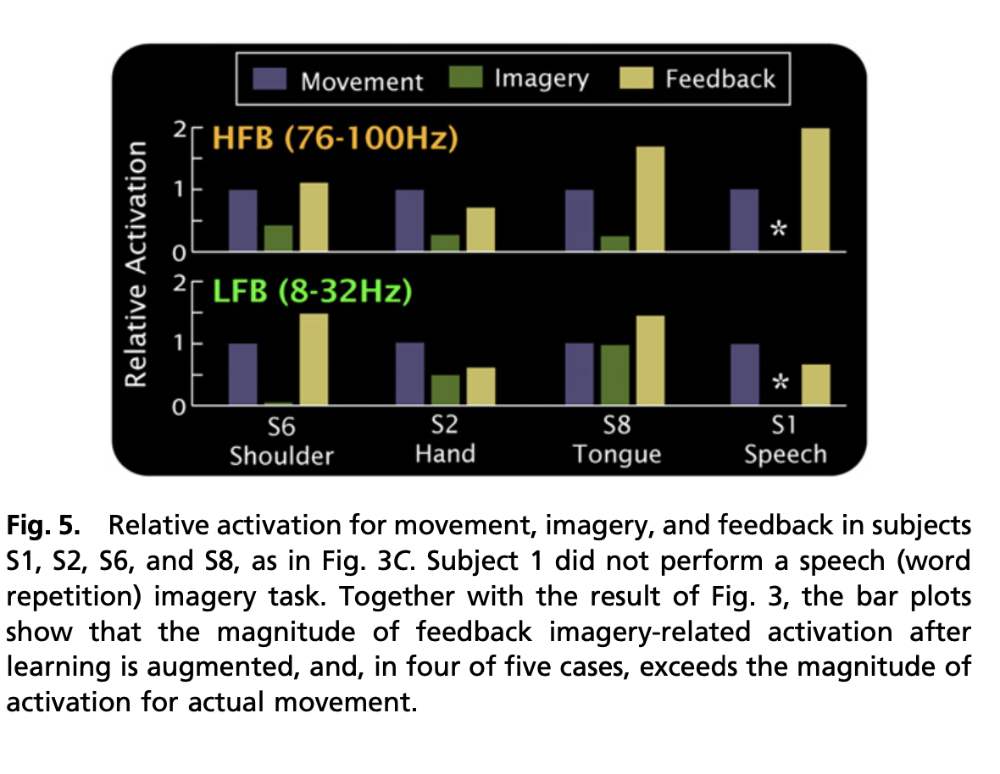

[Context-dependent Computation by Recurrent Dynamics in Prefrontal Cortex](https://www.ncbi.nlm.nih.gov/pmc/articles/PMC4121670/pdf/nihms530595.pdf) by [Valerio Mante](https://scholar.google.ch/citations?user=2hu9WYkAAAAJ&hl=en) and [William T. Newsome](https://scholar.google.ch/citations?hl=en&user=ESrxVR8AAAAJ)

Mante, Valerio, et al. "Context-dependent computation by recurrent dynamics in prefrontal cortex." nature 503.7474 (2013): 78-84.
 <!-- -   -->
- **TODO: read this again..understood maybe 30%**
- **Sorry this does not include the figures**. I strongly recommend looking at the linked paper above and using those figures while reading / understanding this text. It heavily relies on the figures to represent multi-dimensional trajectory.
- Introduction
    - Behavioral context switching through gating of attention.
    - Prefrontal cortex (PFC) top down modulation of neural activity in early sensory areas via modulation of firing rate / response synchrony.
    - Macaque monkey perceptual discrimination of direction or colored random dot display cue.
    - Selection in PFC happens after integration of sensory input.
    - Late selection mechnaisnm because the representations are not seperabble until that point and this is demonstrated in RNN trained on this task.
- Results
    - Figure 1 covered below.
    - Monkeys saccade to random dot stimulus based on motion-context or color-context. Context triggered by different fixation cues (top right of Fig 1).
    - Color coherence led the  targets to right choice with sigmoidal curve.
    - Motion coherence in random dots as liner relationship with correct target chioce.
    - Thus "the choices of the monkeys depended strongly on the direction of motion of the dots (Fig. 1c), while depending only weakly on color in the same trials (Fig. 1d)," (Mante 2013). 
    - The opposite pattern held in the color context.
    - Study population responses as a trajectory in state space instead of studying single unit responses.
    - PCA to 12 dimensions and then linear regression to define the four orthogonal, task-related axes of choice, motion, color, and context. Then project PCA onto these four axes.
        - Interested in how this works so I'll fill in details from the methods here later.
    - The resulting projected trajectories show different arcs toward ending state. One dot selection resulted in a downwards arc and the other resulted in an upwards args. The strength of the evidence resulted in different magnitude of arc in trajectory.
    - When dots offset, arcs return to origin.
    - Relation betwen top row and bottom row in Fig. 2 shows that context did not change trajectories. But "the responses during the motion and color contexts occupy different parts of state space, and the corresponding trajectories are well separated along the axis of context," (Mante 2013).
    - Because magnitude of input has strong impact on deflection but (contextually) no impact on behavior, is suggests non-relevant information is processed in PFC and that early selection and integration of info does not happen.
        - Monkey F shows different results.
    - **"the selective integration of the motion input in monkeys A and F, and of the color input in monkey A, must rely on a mechanism for which the very same input into PFC leads to movement along a fixed axis of choice in one context but not another," (Mante 2013).**
    - **NOTE**: now notes switch to discussing RNN model.
    - RNN network model recieved color/motion/context input.
    - For RNN model, as inputs are integrated the population response moves along the choice axis.
    - Mommentary motion and color push the traj. away from the choice axis and toward respective axes.
    - "the direction of the axes of choice, motion, and color are largely invariant with context, as are the strength of the motion and color inputs, since these are not gated before entering the network".
    - "the trajectories during motion and color contexts are separated along the axis of context."
    - Fixed point analysis of the model (see review 38), shows fixed points that form two seperate lines over the choice axis. These paths are sperated in axis of context.
    - "Second, the responses around each fixed point are approximately stable only along a single dimension pointing towards the neighboring fixed points (red lines), while responses along any other dimension rapidly collapse back to the fixed points,"(Mante 2013).
    - "The integration of the relevant evidence is thus implemented in the model as movement along an approximate line attractor. The model population response, however, does not move strictly along the line attractor."
    - "Both the motion and color inputs (i.e. the corresponding pulses) have substantial projections onto the line attractor (Fig. 6a) but, crucially, the size of these projections does not predict the extent to which each input will be integrated,".
    - "The selection of the inputs instead relies on context-dependent relaxation of the network dynamics after the end of the pulse, which reverses movement along the line attractor caused by the irrelevant pulse (Fig. 6a, top right and bottom left) and enhances the effects of the relevant pulse (Fig. 6a, top left and bottom right). These relaxation dynamics, while counterintuitive, nevertheless follow a very simple rule. For a given context, the relaxation always occurs on a path that is orthogonal to a specific direction in state space, which we call the ‘selection vector’ (Fig. 6b), "
- Discussion
    - Stable traj. show different perpective to results where single neuron varies a lot depending on sensory input.
    - Function of PFC may be to take a mixture of sensory inputs and send them into seperable representations.
