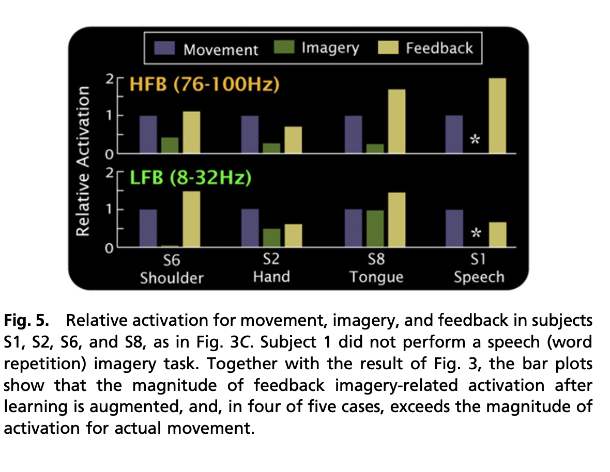

[Neural Ordinary Differential Equations](https://arxiv.org/pdf/1806.07366.pdf) by [Ricky T. Q. Chen](https://www.cs.toronto.edu/~rtqichen/) and [David Duvenaud](http://www.cs.toronto.edu/~duvenaud/)

Chen, Ricky TQ, et al. "Neural ordinary differential equations." Advances in neural information processing systems 31 (2018
 <!-- -   -->
- Introduction
    - Models such as resnets, normalizing flows, or RNN decoders update a hidden state using $h_{t+1} = h_t + f(h_t, \theta_t)$. 
    - In the limit of adding more layers and taking smaller steps in $t=1...T$ we can parameterize the dynamics for the hidden layer using ODE:
    $$ \frac{dh(t)}{dt} = f(h_t,t, \theta_t) $$
    - Then starting from input $h(0)$ we can use ODE to solve $h(T)$.
    - Benefits
        - No backprop required for ODE solver using methods from Neural ODE paper.
        - Adapative computation for ODE solver.
        - _Scalable and Invertible Normalizing Flows_.
        - **Continuous Timeseries models**. 
- Reverse mode autodiff of ODE solutions
    - **Adjoint sensitivity**: treat ODE solver as black-box and compute gradients by solving a second ODE backwards in time.
    - $L(z(t_1)) = L(z(t_0) + \int_{t_0}^{t_1}f(z(t),t,\theta))dt = L(ODESolve(z(t_0),f, t_0, t_1,\theta))$
    - To optimize L, we need to track gradients w.r.t $\theta$
        - To do that we track gradient of loss w.r.t to hidden state, also known as the **adjoint**  $\frac{\partial L }{\partial z(t)}$ as well as the dynamics of that ODE given by the instantaneous chain rule:
        $$
        \frac{d a(t)}{dt} = -a(t)^T frac{\partial (f(z(t),t, \theta))  }{\partial z}
        $$  which can be solved at an intial state by solving an ODE, and the adjoint, backwards.