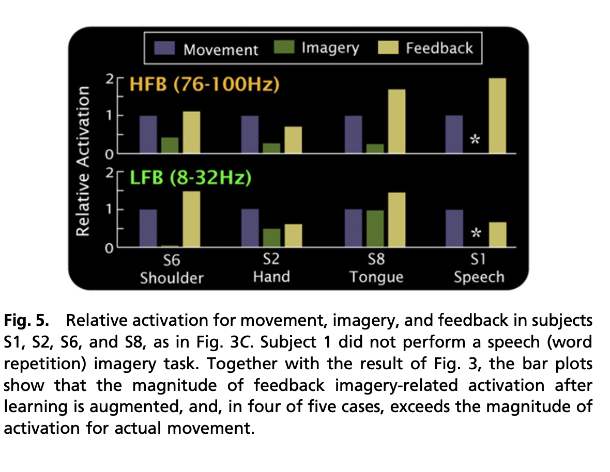
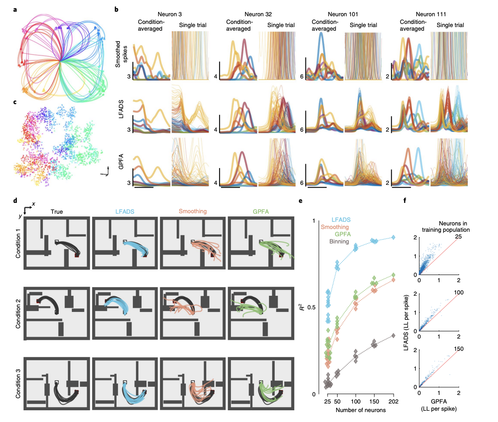
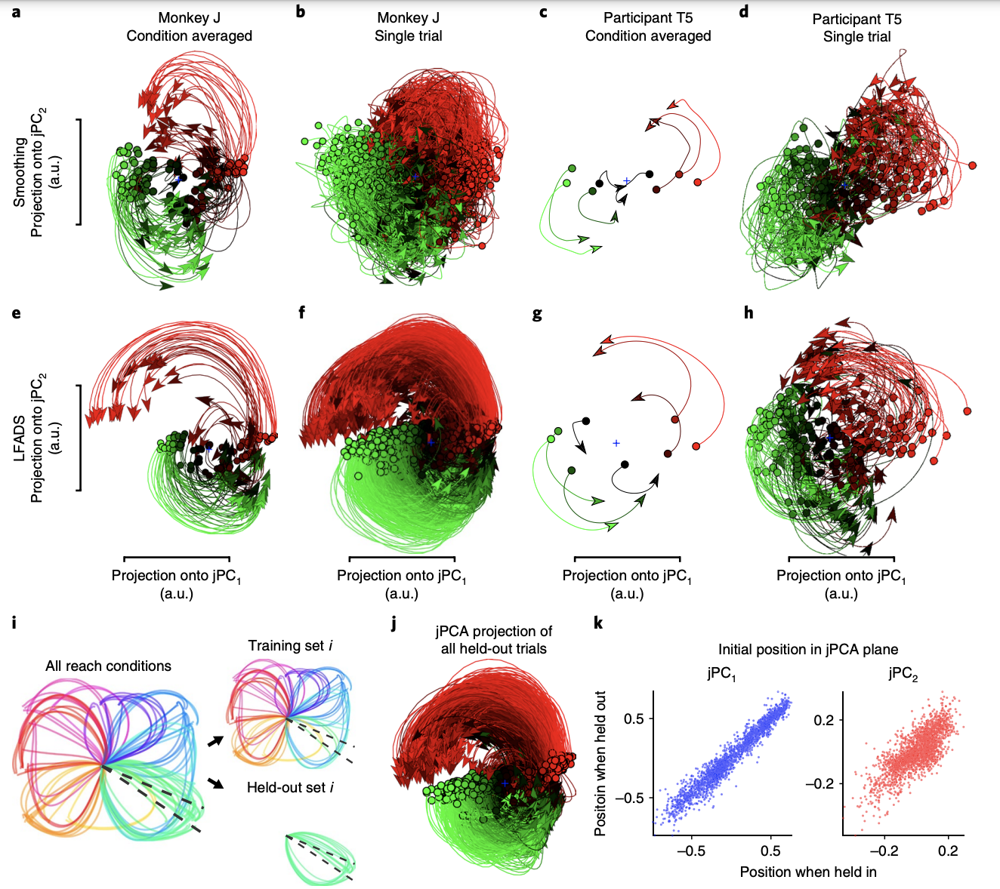
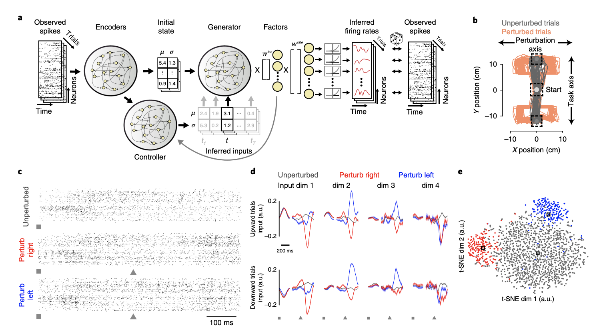

[Inferring single-trial neural population dynamics using sequential auto-encoders](https://www.nature.com/articles/s41592-018-0109-9) by [Chethan Pandarinath](https://bme.gatech.edu/bme/faculty/Chethan-Pandarinath) and [David Sussillo](https://scholar.google.com/citations?user=ebBgMSkAAAAJ&hl=en)

Pandarinath, Chethan, et al. "Inferring single-trial neural population dynamics using sequential auto-encoders." Nature methods 15.10 (2018): 805-815.

 <!-- -   -->
- Introduction
    - Recovering population dynamics for a single trial is challenging so people often use averaged dynamics (eg; avg. firing rate) to evaluate latent models.
    - Again, LFADS models the dynamical system $\dot{x}(t) = F(x(t), u(t))$ where $u(t)$ is an optional input and $x(t)$ is spiking data at some time.
    - This formulation as a dynamical systems relies of four key assumptions:
        - underlying dynamics are being recorded.
        - trial specific conditions that reflect the state of the neural population at a specific point in time.
        - effects of exogenous areas in the brain from unepexpected sensory or context changes during task.
        - spiking variablity according to a Poisson distribution.
    - To understand more about LFADS, read review 38.
    - In this paper they apply LFADS rhesus macaque M1 (motor) and PMd (dorsal premotor), as well as human M1, showing that:
        - LFADS recovers previously studied rotational dynamics.
        - Rates extracted by LFADS estimate behavioral variables more accurately than other techniques.
        - Learned dynamical system is predictive of behavioral conditions it was not trained to model.
        - Infer inputs to neural circuit by analyzing data from an arm reaching task involving a mid-trial peterbuation and by testing whether it can uncover high-frequency oscillations in the rates associated with local field potentials (LFPs).
    - Results
        - Supp. info contains some interesting info Lorenz attractor, chaotic RNN, chaotic RNN w/ pulse inputs etc.)
        - Benchmark methods: Gaussian Process Factor Analysis (GPFA), variational latent Gaussian Proces (vlGP),  Poisson feed-forward neural network linear dynamical system (PfLDS).
        - Validation of LFADS using complex reaching tsak.
            - 202 neurons recorded, 2300 trials of striaght and curved reaches.
        - Fig. 1 is fairly straightforward - just shows LFADS pipeline and that after stimulus onset latent factors firing rate seems to change (not sure if it increases or decreases) for different factors.
        - LFADS inferred rates reproduce patterns of correlations across time (Supp. Data 2) and across Neurons (via cross correleogram in Supp. Data 3). 
        - $R^2$ correlation of .9 in inferring hand velocities from LFADS, compared to $.66,.69$ and $.34$ using smoothing spike trains , GPFA, and binning spike trains respectively.
        - Generalized Linear Model (GLM) to relate held out neuron firing data to inferred firing rates.

       
        - Figure 2 Simplified Caption
            - A: Monkey reach trajectories.
            - B: Top: Smoothed firing rate (avg. over trials on left and single trial right) middle: LFADS inferred. Bottom: GPFA inferred.
            - C: tSNE of intial states $z_0$ by reach path.
            - D: colored traj - decoded reach kinematics and black - reach kinematics for a condition.
            - E: $R^2$ variance explained in decoded velocities for different methods.
            - F: Log Likelihood (LL) per spike.
    - Uncovering rotational dynamics in M1
        - Can LFADS recover rotational dynamics that happen in pre ->  peri-movement activity in monkeys and humans?
        - Not only is the answer yes on averaged responses. But by using jPCA on LFADS inferred rates, we see the first case of inferred rotational dyanmics for a single trial.

         
        - Figure 3 Simplified Caption
            - A/C: Conditioned averaged reaching trajectories projected onto jPCA components.
            - B/D: Single trial reaching trajectories projected onto jPCA components.
            - E/G: Same as A/C but inferred by LFADS.
            - F/H: Same as B/D but inferred by LFADS.
            - I: reach generalization task using same starting state $z_0$ and different reach kinematics.
            - J: Held out averaged reaching proj onto jPCA.
            - K: Held out / Held in correspondance in jPCA components.
        - Figure 3 panel K as proof that LFADS dynamics can generalize to novel conditions given that there are related datasets with the right # of trials etc.
    - Stitching together data from multiple sessions
        - The summary of this is that by attaching session-based weights to the input and output layers of LFADS, the same dynamical system can model purpotedly different populations of neurons performing the same task.
        - Stiched LFADS gets $r^2$ correlation of .76 while other baselines are < .2 and single trial LFADS is < .5.
        - Trajectories were highly similar for different reach directions regardless of recording session, indicating that LFADS found a generator capable of describing all datasets with a consistent set of factors.
    - **Inferring inputs to a neural circuit**.
        - Adapt LFADS to model a non-autonomous system which is critical to accomodate unmeasured inputs, such as changes in contextual inputs, sensory inputs, or changes in task.
        - With an accurate model it should be possible to identify when (or what) exogenous changes are ocurring.
        - Monkey moves cursor in predictable pattern for 75% and unpredictable for 25% of the trials. Unpredictable = cursor position is peturbed and monkey must adapt in the task for the new position.
        - LFADS inferred different input patterns for right- and left-shift perturbed trials and for unperturbed trials (5D).
        - tSNE shows trials cluster based on peturbation / non-peturbation identity.

        
        - Figure 5 abbreviated caption:
            - A: $u_t$ or inferred inputs are produced by a controlller that defines a distribution over $u_t$, which is random normal Gaussian. The controller requires the previous latent (grey feedback arrow) factors as well as the intial state.
            - B: Schmatic of cursor jump tasks. Upward / downward targets and peturbed trails are shown in orange.
            - C: spiking activity during trials.
            - D: Peturbations shown in latent factors are clear and homogenous across upward / downward trials (red=peturb right, blue=peturb left).
            - E. tSNE of peturbation types. Again red = right, blue = left.
    - LFADS rate oscillations correlate with LFP.
        - Tested whether LFADS is capable of extracting high-frequency phase locking (15-40hz) during movement.
        - "Although we did not give the model access to the LFPs, the inferred oscillations aligned well with LFPs and with structure apparent in the multi-unit spiking activity (Fig. 6a),"
        - unable to robustly reproduce the correlations between LFADS-inferred rates and LFPs on held-out trials without the use of inferred inputs --> fast dynamics are not highly reliant on underlying dynamical system but rely more on intial starting state during trial.
- Discussion
    - Close link betwen LFADS latent dynamical representations and the observed behaviors suggest network states and dynamics (not individual neurons) are largely important for understanding the computation for brain areas.
    - **We advise against making inferences about properties of the biological network by studying the structure of the generator.**
    - Same level of caution in using LFADS inferred inputs in situations where more noise or modeling error is present.
        - **There is no constraint forcing the inputs to be causal with respect to the task perturbation.**
    -  

        
